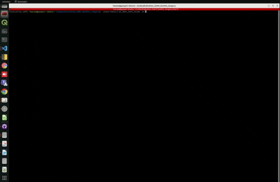

# Evaluation SAM3 on Benthic Imagery

## Overview
This repository shows a demo of Segment Anything Model 3 (SAM3) on benthic imagery datasets. 

## Requirements
Make sure to download sam3.pt from https://ai.meta.com/research/sam3/ 
## Installation
```bash
git clone https://github.com/yourusername/Evaluation_SAM3_benthic_imagery.git
cd Evaluation_SAM3_benthic_imagery
conda env create -f environment.yml
pip install -e .
```

## Usage

To run the model on a single image, use the following command:
```bash
./experiments/run_demo_SAM3_image.sh
```

To run the model on a folder containing multiple images, execute:
```bash
./experiments/run_demo_SAM3_folder.sh
```


## Visual exempler prompt mode

 A demo of running SAM3 on the visual exempler prompt on benthic imagery for segmentation


https://github.com/user-attachments/assets/116b1b79-24df-4b58-b3f6-128ba6bf4fdc


```markdown

```